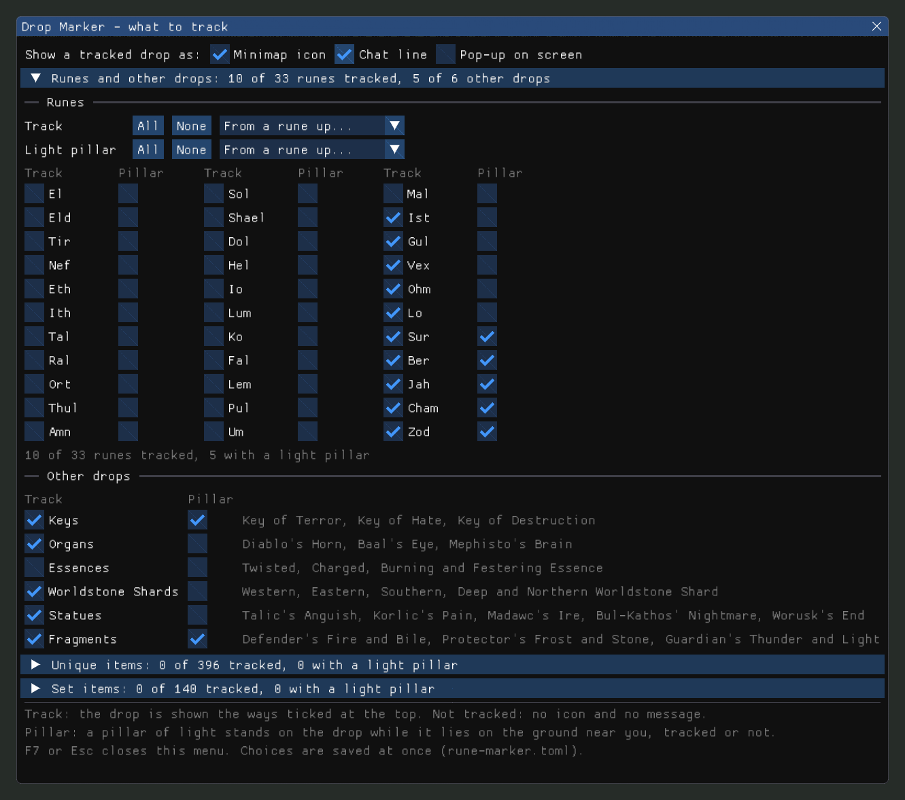
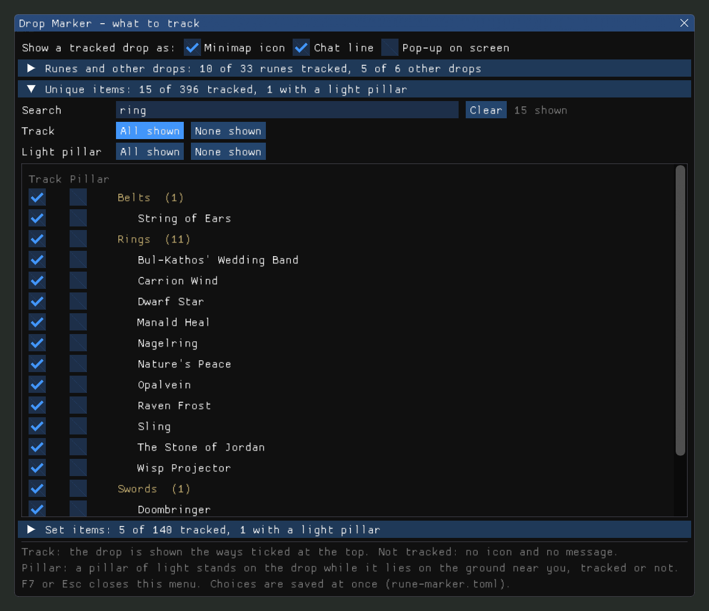

# Drop Marker

A [D2RLoader](https://d2rloader.net) plugin for Diablo II: Resurrected that tells you when something you care
about drops, and where it is.

You choose what counts: any of the 33 runes; keys, organs, essences, Worldstone Shards and the Ancients'
statues; and, since 1.6, any of the game's unique and set items, one by one. When one of those drops it gets

- an **icon on the minimap** for as long as it lies on the ground,
- a **line in the game's chat** ("Ber Rune dropped"), and/or
- a **pop-up on screen** for a few seconds.

Each of the three is a switch. Since 1.5 a drop can also get

- a **pillar of light** standing on it for as long as it lies on the ground near you, so you see it with the
  map closed and after the line has scrolled away.

The pillar is chosen drop by drop, with a tick box of its own beside every rune and every group: on your high
runes only, say. Anything you neither track nor give a pillar is never shown. That is all the plugin does: no
cheats, no console command, nothing about the game's rules is changed.





Drop Marker is a cut-down build of [CabbyCodes](https://github.com/SirCabby/D2RCabbyCodes) by SirCabby, with a
drop message and a menu added. See [Where it comes from](#where-it-comes-from).

## Install

1. Close the game.
2. Put `d2rl-rune-marker.dll` into `<game folder>\d2rloader\plugins\`.
3. Start the game through D2RLoader.

A few seconds into your first game a line says "Drop Marker is on - F7 opens its menu (what to track)".

Do not install it next to CabbyCodes itself: both want the same game routines, and the loader gives a routine
to one plugin only. CabbyCodes already has the map marks; this plugin is for people who want only that.

If you play with others over TCP/IP, everyone needs the plugin: the loader counts it among the plugins all
players of a game must share.

## Using it

Press **F7** in a game. The menu has

- the three ways a tracked drop is shown, as tick boxes;
- every rune with two tick boxes: **Track** (the one with its name) and **Pillar**. Each of the two has its own
  **All**, **None** and "from a rune up" (pick Lem and everything from Lem to Zod is ticked);
- the other drops as groups, with the same two boxes: keys, organs, essences, Worldstone Shards, statues, and
  the fragments (Defender's, Protector's and Guardian's; not tracked by default).

The two are apart: a rune can be tracked without a pillar, or have a pillar without being tracked. As
installed, everything but the fragments is tracked, and Vex and every higher rune has a pillar.

The menu has three parts, each a line that folds out, one open at a time: the runes and other drops (open as
the menu comes up), **Unique items** and **Set items**. Those two are lists too long for tick boxes side by
side - 396 unique items and 140 set items - so each is a **search box** over a list that scrolls:

- type part of a name ("griff", "tal r"), or a kind or a set ("ring", "sword", "immortal");
- every item has the same two boxes, Track and Pillar; the row of a kind or a set ticks all of it that is
  listed; **All shown** and **None shown** do the same for the whole list as the search has it;
- the closed line says how many are chosen.

None is chosen as installed. A chosen unique or set item is said **by its own name** as it drops, before it is
identified: "Harlequin Crest dropped". (The game shows only the base item until then. With single items
chosen, the mark itself tells you which one it is.)

Choices are saved at once to `<game folder>\d2rloader\config\rune-marker.toml`. The file can also be edited by
hand with the game closed; its comments explain every setting, including how to move the menu to another key
and how to switch the plugin's log off. (The file and the log are named after the plugin's first name, Rune
Marker. They keep that name so existing settings carry over.)

Runes are marked with an orange rune stone, an orange line and an orange pillar; the other drops and the
unique items with a gold star, a gold line and a gold pillar; set items with a green mark, a green line and
a green pillar.

## What to expect

- **Tested with** D2RLoader 1.3.1-beta on the Steam release of the game, version 3.4.95041. Nothing else has
  been tried: not other loader versions, not the Battle.net release.
- The plugin finds the game routines it needs by their byte patterns and checks them before it touches
  anything. On a build where one is not found it leaves that part off and says so in its log
  (`<game folder>\d2rloader\logs\rune-marker.log`).
- The chat line goes through a routine inside D2RLoader's own `D2RCore.dll`. If a loader update changes that
  routine, the plugin notices and shows the line as a pop-up instead. The log says why.
- Overlays that take over the game's frame presentation (Steam's, Discord's, RTSS) do not stop the menu: it is
  then drawn from the game's own present routine. The log notes it once.
- Version 1.5.0 follows 1.0.0, with nothing between. D2RLoader remembers, for each character, the versions of
  the plugins it was last played with, and warns ("Requires newer plugin") when an installed one is older.
  This plugin's builds from before its first release carried the number 1.4.2, so the number had to pass that.
- A drop is announced once per game. Picking it up removes its icon and its pillar.
- The unique and set items are the ones of game version 3.4 (the list is built into the plugin: 403 unique
  items that can drop, the eight Rainbow Facets as one entry, and 140 set items). An item is known by its row
  in the game's table and checked by its base item, so with a mod that puts other items into those tables the
  changed ones are simply not marked, never marked under a wrong name. Their names are shown in the game's
  language; the settings file keeps them in English.
- The pillars are drawn over the game's picture, they are not lights in its world. So a pillar is not hidden
  by a wall in front of it, it is there only for drops near your character (what the game has around you),
  and it is left out where an open inventory or character panel covers its half of the screen, and under the
  Esc menu. They need the game's HD graphics: legacy graphics show none, and the menu says so.
- It hooks five routines of the game, all through the loader: the present routine (for the menu and the
  pillars), the per-frame player tick, the drop routine, the item notice and the automap's marker decision.
  It also listens to the game's UI messages, through the loader, for one thing: whether the Esc menu is open.

## Uninstall

Close the game and delete `d2rl-rune-marker.dll`. The settings file can stay or go. No game file was changed.

## Building it

The plugin is built with GCC (mingw-w64), on Linux as CabbyCodes is, or on Windows with a kit such as
w64devkit:

```
make RUNES_ONLY=1
```

gives `build/runes/d2rl-rune-marker.dll`. Plain `make` still builds CabbyCodes itself from the same tree,
unchanged. The version of Drop Marker is in `VERSION.drop-marker`; `VERSION` is CabbyCodes' own.

Three tests run without the game; how to build each is at the top of its file:

- `tests/test_track.cpp` - what is tracked, the lists of unique and set items, and the settings file read and
  written back
- `tests/test_chatline.cpp` - finding and checking the loader's chat routine (needs a real `D2RCore.dll`)
- `tests/test_trackmenu.cpp` - the menu, drawn and clicked without a screen, and the pillar's look painted to
  pictures

## Where it comes from

This repository is a fork of [SirCabby/D2RCabbyCodes](https://github.com/SirCabby/D2RCabbyCodes), taken at
CabbyCodes 1.4.2 (commit `0bf3385`, 2026-11-05). CabbyCodes is an in-game cheat panel with a great deal more
in it; its own read-me is kept here as [README-CabbyCodes.md](README-CabbyCodes.md). All of that is SirCabby's
work, and so is the code Drop Marker runs on: the way routines are found and hooked, the map icons, the
overlay. (The original project's file of working notes is not carried in this fork; it is in SirCabby's
repository.)

What was changed here, in November 2026:

- a second build of the tree, `make RUNES_ONLY=1`, that compiles 20 of the 43 source files and leaves every
  cheat, the panel and the console command out;
- tracking by choice (`src/track.*`) and the menu for it (`src/trackmenu.*`);
- the line said as a tracked item drops, in the game's chat or as a pop-up (`src/chatline.*`, `src/toast.*`);
- keys, organs, essences, Worldstone Shards, statues and fragments beside the runes;
- the pillar of light on a chosen drop (`src/pillars.*`, `src/pillarart.h`), placed by the game's own
  projection of a unit to the screen, the routine under the one CabbyCodes' health bars ask;
- the unique and set items one by one (`src/named.*`; `src/named_items.h` is made from the game's tables by
  `tools/make_named_items.ps1`), with CabbyCodes' own marks for those two kinds of item;
- its own plugin id, settings file, log, version and name.

Drop Marker is not SirCabby's release and he is not responsible for it. Problems with it belong in this
repository's issues, not his.

## License

GPL-3.0, as CabbyCodes is: see [LICENSE](LICENSE). The bundled libraries keep their own licenses, in
`contrib/`: Dear ImGui (MIT), MinHook (BSD 2-Clause) and the D2RLoader PluginSDK (MIT).

Not affiliated with Blizzard Entertainment.
